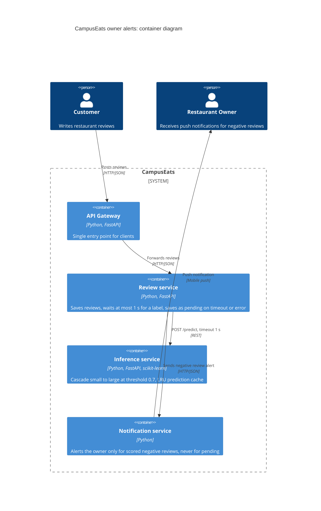

# Task 4: Deployment topologies and trade-offs

**Name / ชื่อ:** ยสินทร สันนิภางกูร

**Student ID / รหัสนิสิต:** 6630275021

This is **individual work**: each student completes and submits their own copy, in their own fork.

*งานนี้เป็น**งานเดี่ยว** นิสิตแต่ละคนทำและส่งงานของตัวเอง ใน fork ของตัวเอง*

**Scenario (A, B or C) / Scenario ที่เลือก:** A

Choose **one** scenario below. If the last digit of your student ID is odd, take A or B; if it is even, take B or C. Use your measurements from Tutorial 6 as evidence: cite run names from `results/runs.csv`. Answer in Thai or English.

เลือก scenario **หนึ่ง** ข้อด้านล่าง ถ้าเลขตัวสุดท้ายของรหัสนิสิตเป็นเลขคี่ ให้เลือก A หรือ B ถ้าเป็นเลขคู่ ให้เลือก B หรือ C ใช้ผลการวัดจาก tutorial ที่ทำไปเป็นข้อมูลอ้างอิง โดยอ้างชื่อ run จาก `results/runs.csv` จะตอบเป็นภาษาไทยหรือภาษาอังกฤษก็ได้

Facts that hold in every scenario / ข้อเท็จจริงที่ใช้กับทุก scenario:

- The large model serves at most **20 calls per second** (4 calls at once × about 200 ms each), and every call costs money.

  *large model รับได้สูงสุด **20 calls ต่อวินาที** (พร้อมกัน 4 calls × ประมาณ 200 ms ต่อ call) และทุก call มีค่าใช้จ่าย*
- The small model is fast and cheap enough to run anywhere, including inside the review service or on a kiosk, but it is much less accurate on its own.

  *small model เร็วและถูกพอที่จะรันที่ไหนก็ได้ รวมถึงภายใน review service หรือบน kiosk แต่ถ้าใช้ตัวเดียวจะแม่นน้อยกว่ามาก*

## Scenarios

**A. Owner alerts.** When a customer posts a negative review, the restaurant owner gets a push notification within **2 seconds**. At the lunch peak, CampusEats receives **40 reviews per second**. A missed alert is acceptable, but a wrong alert (for example, "your customer is unhappy" when they are happy) makes owners stop trusting alerts and, in the end, ignore them.

*เมื่อลูกค้าโพสต์รีวิวเชิงลบ เจ้าของร้านจะต้องได้รับ push notification ภายใน **2 วินาที** เวลาช่วงพีคตอนเที่ยง CampusEats ได้รับรีวิวจำนวน **40 รายการต่อวินาที** การพลาด alert ไปบ้างนั้นยอมรับได้ แต่ alert ที่ผิด (เช่น "ลูกค้าไม่พอใจ" ทั้งที่จริงๆ แล้วพอใจ) จะทำให้เจ้าของร้านไม่เชื่อถือและเลิกสนใจ alert ในที่สุด*

**B. Canteen kiosk.** A tablet in each canteen lets students leave a review on the spot. However, the canteen Wi-Fi is poor: the tablets lose their connection several times a day, for minutes at a time. The system must accept every review, even while a tablet is offline. Restaurant owners need the labels **by the end of the day**.

*มี tablet ในแต่ละโรงอาหารให้นิสิตรีวิวได้ทันที อย่างไรก็ดี การเชื่อมต่อ Wi-Fi ในโรงอาหารไม่ดี ทำให้ tablet หลุดการเชื่อมต่อวันละหลายครั้ง ครั้งละหลายนาที ระบบจะต้องรับรีวิวได้ทุกรายการแม้ขณะที่กำลัง offline อยู่ และเจ้าของร้านต้องการ label **ภายในสิ้นวัน***

**C. Weekly report.** Restaurant owners want a weekly sentiment report. Nothing in producing this report has to be real-time. **Accuracy matters most** and **cost must be minimal**.

*เจ้าของร้านต้องการรายงาน sentiment รายสัปดาห์ ไม่มีอะไรที่จะต้องทำแบบ real-time ในการออกรายงานนี้ ความแม่นยำ **(accuracy) สำคัญที่สุด** และ **ค่าใช้จ่ายต้องน้อยที่สุด***

## Topologies and patterns to choose from / Topology และ pattern ที่เลือกใช้ได้

| | Topology | Where the model runs / โมเดลรันที่ไหน |
|---|---|---|
| T1 | Model as a service, synchronous | Inference service, called for each review (today's baseline) *inference service ถูกเรียกทุกรีวิว (baseline ของวันนี้)* |
| T2 | Model as a library | Inside the review service, or on the device *ภายใน review service หรือบนอุปกรณ์* |
| T3 | Hybrid | Small model locally, large model as a remote service *small model รันในเครื่อง large model เป็น remote service* |
| T4 | Asynchronous / batch | Reviews are queued (broker, W10) or stored, and scored later in bulk *รีวิวถูกเข้าคิว (broker, W10) หรือเก็บไว้ แล้วติด label ทีหลังเป็นชุด* |

Combine one topology with any of the patterns from Tutorial 6: **fallback**, **cascade** and **cache**.

*เลือก topology หนึ่งแบบ แล้วผสมกับ pattern จาก Tutorial 6 ได้ตามต้องการ: **fallback**, **cascade** และ **cache***

## 1. Quality requirements

The three most important quality requirements for your scenario, each with a number where possible.

*quality requirements ที่สำคัญที่สุด 3 ข้อของ scenario ที่เลือก ระบุตัวเลขเมื่อทำได้*

| # | Quality | Requirement |
|---|---|---|
| 1 | Accuracy | alert ต้องถูกอย่างน้อย 91% เพื่อไม่ให้เกิดความเข้าใจผิด |
| 2 | Performance | เมื่อมีข้อความมา 40review/s ต้อง alert ข้อความลบภายใน 95% ของ alert 2วินาที |
| 3 | Capacity | การันตีในช่วงพีค 40รีวิว/s ตาม large model โดยเรียก large ไม่เกิน 20 calls/s |

## 2. Design / การออกแบบ

Your topology, the patterns you add, and a container-level diagram (C4 level 2). The C4 diagram must be written in Mermaid.

*topology ที่เลือก pattern ที่เพิ่ม และ diagram ระดับ container (C4 level 2) เขียนด้วย Mermaid*

**Topology:** T1

**Patterns:** fallback, cache, cascade

## 3. Evidence / หลักฐาน

Which runs support your choice? Show the numbers and, for scenario A, the capacity arithmetic: how many large-model calls per second does your design need at the peak?

*run ไหนที่สนับสนุนการตัดสินใจของนิสิต ให้นิสิตแสดงตัวเลขประกอบ และสำหรับ scenario A ให้นิสิตแสดงการคำนวณ capacity ด้วย เพื่อแสดงว่าในช่วงพีคนั้น design ของนิสิตต้องใช้ large model กี่ calls ต่อวินาที*

| Run | What it shows / แสดงอะไร |
|---|---|
| t3-cache | accuracy 93% >= 91%, p95 545ms < 2s, large calls 38% = 15.2calls/s < 20 ผ่านทั้งสามข้อ  |
| t2-0.7 | large calls 53% = 21.2 calls/s เกินเพดาน 20 ส่วน accuracy 93.0% เท่ากับ t3-cache แปลว่า cache ลด cost ได้โดย accuracy ไม่ลดลง |
| t1-after | errors ลดจาก 18 ใน t1-before เหลือ 0, รีวิว pending 25 รายการไม่หาย และไม่ถูกส่ง alert| 
| t0-large | 40 calls/s เกินเพดานไปเท่าตัว ระบบรับช่วงพีคไม่ได้ |

t0-large: 40 x 100% = 40call/s    เกิน
t2-0.7: 40 x 53% = 21.2calls/s    เกิน
t3-cache: 40 x 38% = 15.2calls/s  ผ่าน
design ใช้ 15.2 calls/s เหลือว่าง 4.8 calls/s ถ้า cache hit จริงต่ำกว่าที่วัด จนเกิน 20 คิวจะยาวขึ้นและ request จะ timeout กลายเป็น pending ซึ่งแปลว่าพลาด alert ไม่ใช่ alert ผิด จึงยังยอมรับได้ตามโจทย์

## 4. ADR

Use the ADR format from W5.

*ใช้รูปแบบ ADR จาก W5*

**Title:** แจ้งเตือนรีวิวเชิงลบให้กับเจ้าของร้านด้วย T1 และ pattern fallback, cascade, cache

**Status:** Proposed

**Context:** ต้องส่ง alert ภายใน 2 วินาที, ช่วงพีคมี 40รีวิว/s แต่ large รับได้ 20calls/s, alert ผิดแย่กว่าพลาดการ alert

**Decision:** ใช้ topology 1, ใช้ pattern ทั้งสาม fallback, cascade และ cache. รีวิวที่เป็นเชิงลบเท่านั้นที่จะ alert. timeout 1s, threshold 0.7 และ LRU cache. ไม่ส่ง alert ให้กับ review pending

**Consequences:**
- Positive: t3-cache ได้ accuracy 93% ผ่านเป้า 91% ทำให้ alert ส่วนใหญ่ถูกต้องและเจ้าของร้านเชื่อถือ. p95 ของ t3-cache อยู่ที่ 545ms ต่ำกว่าเป้า 2s. large calls ลดจาก 100% ใน t0-large เหลือ 38% ใน t3-cache. ใช้ large 15.2 calls/s ต่ำกว่าเพดาน 20calls/s
- Negative: margin เหลือแค่ 4.8calls/s และขึ้นกับ cache hits ด้วย. รีวิว pending ไม่ได้รับ alert เลย. ถ้าเปลี่ยน model ใหม่ ต้องล้าง cache เก่า และออกแบบโดยใส่ model version ใน cache key 

**Alternatives considered:** at least one topology you rejected, and why.

*อย่างน้อยหนึ่ง topology ที่ไม่เลือก และเหตุผล*

>T4 ไม่เหมาะกับกรณีที่ต้องส่งไปให้ถึงภายใน 2วินาที ในช่วงที่มี request 40reviews/s จะส่งทีหลังเป็นชุด ทำให้ส่งไปไม่ทัน
